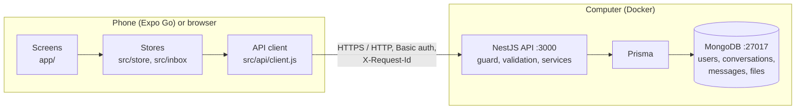

# Natter

Natter is a chat app for a class: direct messages, group chats and photos, on Android and
iOS through Expo Go (and in a browser for testing). It has two parts:

| Folder | What it is |
|---|---|
| [`frontend/`](frontend) | The Expo React Native app (Expo Router, plain JavaScript) |
| [`backend/`](backend) | The NestJS 11 server with Prisma 6 over MongoDB 7 |
| [`swagger.json`](swagger.json) | The API contract both sides follow |

The app only uses the routes in `swagger.json`, so it works against this server and against
any other server that implements the same contract (for example a shared class server).
This server adds read receipts, a log feed for the app's Diagnostics panel, cleanup of
uploads that were never sent, and demo data. None of them change a route or a response shape.

## Quick start

```bash
# 1. Server: MongoDB + API on http://localhost:3000 (needs Docker Desktop)
cd backend
cp .env.example .env
npm run docker:up
npm run docker:seed            # in another terminal, once

# 2. App
cd ../frontend
npm install
npx expo start                 # scan the QR code with Expo Go
# or: npx expo start --web     # open http://localhost:8081
```

Sign in as `zara`, `ishaan`, `noor`, `vikram` or `tara` with the password `natter123`.
Without Docker, see "Setup without Docker" in [`backend/README.md`](backend/README.md).

## How it fits together



- **No push:** the app asks for new data on a timer: the conversation list every 5 s, an open
  conversation every 3 s, and a round over every chat every 10 s for unread counts. Polling
  pauses while the app is in the background, and a chat that keeps failing is checked less often.
- **Optimistic sending:** your message appears at once, then is confirmed or marked as not sent
  (tap to send again).
- **Stateless auth:** every request carries `Authorization: Basic name:password`; the server
  checks it each time.
- **Pagination:** messages come 20 at a time; the oldest id on a page is the cursor for the next.
- **Tracing:** every request has an `X-Request-Id`, which the server attaches to its log lines so
  Diagnostics can match them up.

### Sending a message

```mermaid
sequenceDiagram
  autonumber
  actor U as zara
  participant S as Conversation screen
  participant C as messageController
  participant A as API
  participant M as MongoDB
  U->>S: types, taps send
  S->>C: send(text)
  C->>C: local bubble, state "sending"
  C->>A: POST /message
  alt accepted
    A->>M: messages.create
    A-->>C: 201 + saved message
    C->>C: swap the local bubble for the saved one
  else network error or 4xx/5xx
    A-->>C: error
    C->>C: state "failed"; the banner offers to send again
  end
```

## The app at a glance

- **Phone numbers and contacts:** add your number to your profile; save anyone's number under a
  name (that name is shown everywhere); message any number; invite numbers that aren't on Natter.
- **Messages:** replies with quotes, emoji reactions, edit (15 minutes), delete for me or for
  everyone, forward to up to five chats, star, search inside a chat, photos, camera, documents and
  voice notes, delivery and read ticks.
- **Presence:** online / last seen, and "typing…" in the chat header and the Inbox.
- **Chats:** pin (up to three), mute, archive, clear, block and unblock; groups can be renamed,
  get new members, and be left.
- **Updates:** 24-hour text or photo statuses, with a viewer list for your own.

- **Inbox:** one list of every conversation, newest first, with search and All / Unread /
  Direct / Groups filters. Unread conversations get a marigold count and a cobalt edge.
- **Contacts:** everyone on the server, A to Z. Tap a person to open your conversation, or
  start a new group.
- **Conversation:** day headings, bubbles with the time and delivery ticks inside, photos,
  long-press for Copy and Info (when it was sent and who has read it), members list for groups.
- **You:** profile card, picture style (Initials, Shapes, Characters), theme (System, Light,
  Dark), server status, developer tools and sign out.
- **Banner:** new messages, failed sends and connection changes drop in from the top.
- **Diagnostics:** a developer panel with request flow, network list, logs and test switches.

Design tokens are in `frontend/src/constants/theme.js`; the product name is in
`frontend/src/constants/brand.js` and `frontend/app.json`.

## Tests

```bash
cd frontend && npm test        # Jest unit tests for all the pure logic
cd backend && npx tsc --noEmit # type-check the server
```
